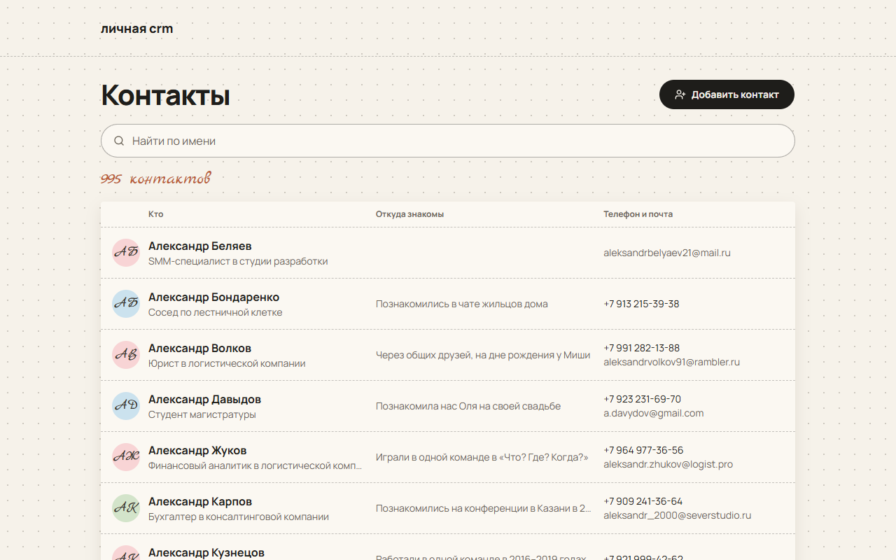
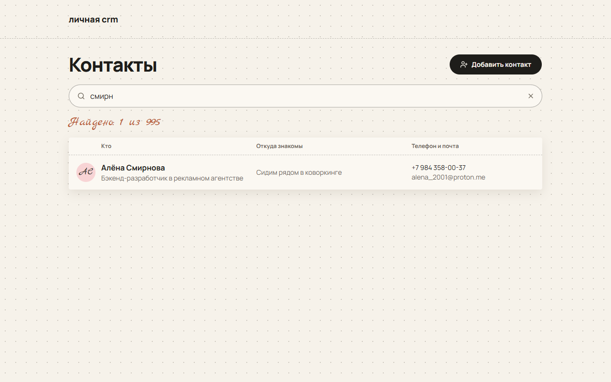
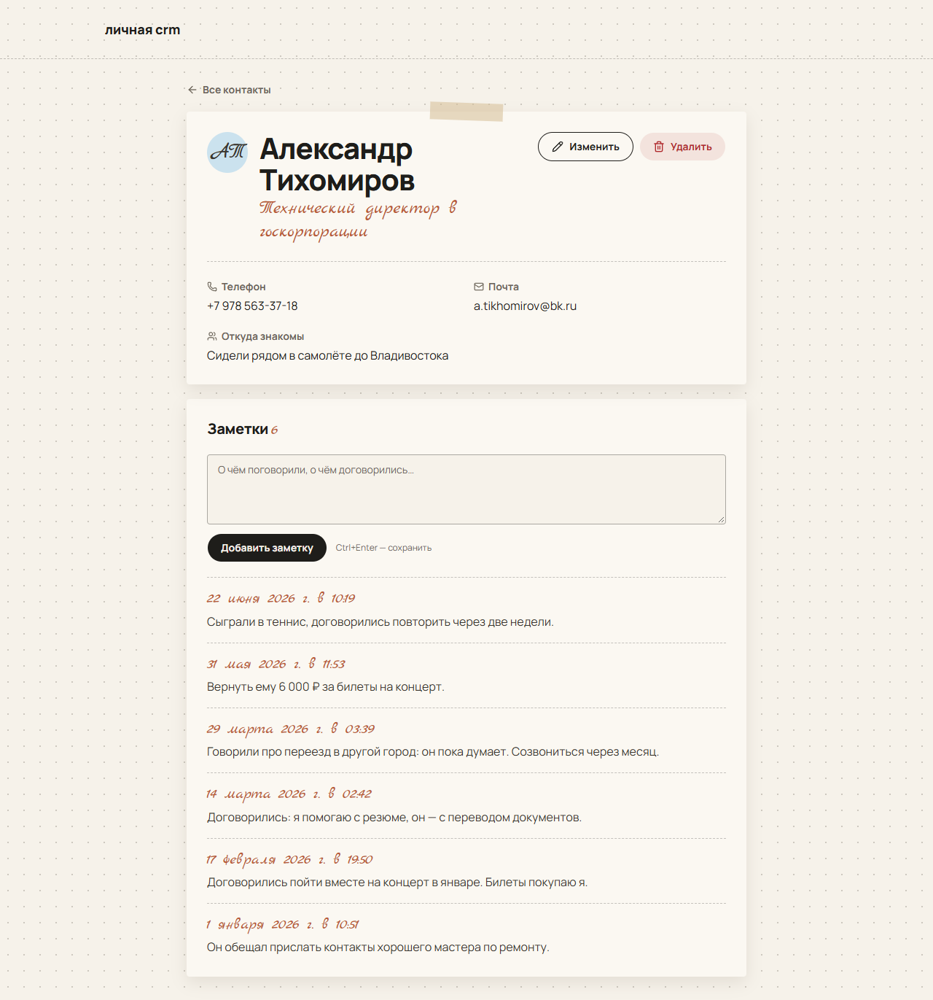
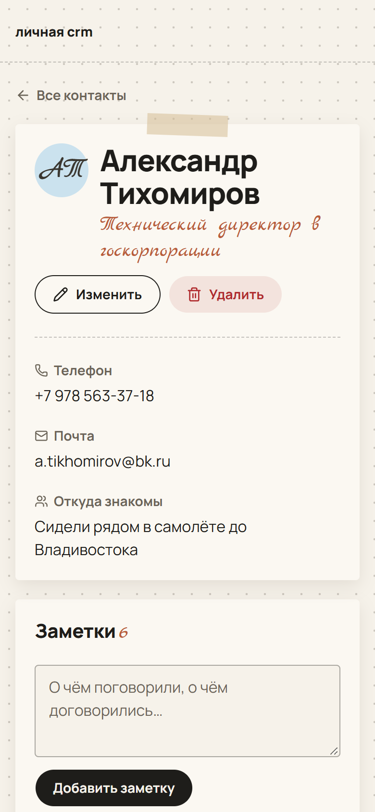

# Личная CRM

Контакты людей, которых я знаю лично: кто это, откуда знакомы, телефон и почта, заметки о разговорах.

## Что умеет

- Вход по ссылке из письма, без паролей: на странице входа вводите почту и жмёте «Получить ссылку», в письме жмёте «Войти». Первый вход и есть регистрация. Ссылка работает один раз и 15 минут; новая ссылка отменяет прежние; на одну почту уходит не больше 3 писем за 10 минут
- Вход держится 30 дней с последнего захода на этом устройстве, можно быть в приложении с нескольких устройств сразу. В шапке — ваша почта и кнопка «Выйти» (переспрашивает «Вы уверены?»; выход — только на этом устройстве)
- У каждого свои данные: контакты, заметки и группы видны и меняются только их владельцем. Чужой контакт по прямой ссылке открывается как несуществующий — «Контакт не найден». Новый пользователь начинает с пустого списка и без групп
- Список всех контактов, отсортированный по имени
- Поиск по имени: можно вводить часть имени и слова в любом порядке, «е» и «ё» не различаются
- Добавление контакта и изменение его данных
- Карточка контакта с заметками: у каждой заметки есть дата, новые сверху. Сохранить заметку можно кнопкой или сочетанием Ctrl+Enter
- Удаление контакта вместе с его заметками: перед удалением приложение переспрашивает, а 5 секунд после удаления его можно вернуть
- Частота общения в карточке контакта, поле «Как часто общаться»: раз в неделю, месяц, квартал или год. Выбор сохраняется сразу, без кнопки «Изменить». Срок отсчитывается от последней заметки, а если заметок нет — от даты добавления контакта
- Своя дата через «Другое…»: день и месяц, например 16.12, год подставляется сам — ближайшая такая дата. Человек появляется в списке «Пора связаться» с этого дня, если после того, как дату задали, не было ни одной заметки
- Поле «Как часто общаться» есть и в форме «Добавить контакт», перед «Группы»: частоту или свою дату можно выбрать сразу. При выборе «Другое…» под списком появляется поле «День и месяц». Всё сохраняется вместе с контактом кнопкой «Добавить контакт»; неверная дата — сообщение под полем, контакт не добавляется. В форме «Изменить» этого поля нет: у созданного контакта частоту меняют в карточке
- Страница «Пора связаться»: люди, с которыми срок общения прошёл. Сверху те, у кого срок превышен сильнее. В строке — кто это, дата и начало последней заметки, чтобы вспомнить, о чём говорили. Новая заметка в карточке убирает человека из списка
- Кнопка «Пора связаться» на главной рядом с «Добавить контакт» — с числом людей, которым пора написать
- Страница «Группы»: создать группу, переименовать, удалить. Удаление группы не удаляет людей — они просто выходят из неё; перед удалением приложение переспрашивает, а 5 секунд после удаления группу можно вернуть вместе со всеми людьми. У владельца (почта из `OWNER_EMAIL`) после обновления уже есть пять групп: «Семья», «Друзья», «Знакомые», «Теннис», «Аналитики»; у нового пользователя групп нет. Названия групп у разных пользователей могут совпадать
- Поле «Группы» в карточке контакта: метки групп человека. Добавить в группу или убрать из неё можно сразу, без кнопки «Изменить» — выбор сохраняется сам. Если такой группы ещё нет, её можно создать прямо в поле: «Создать группу «…»»
- Поле «Группы» есть и в формах «Добавить контакт» и «Изменить»: там выбор (и новые группы) сохраняется вместе с остальными данными кнопкой «Сохранить», а «Отмена» ничего не меняет
- На главной над списком — ряд кнопок-групп: «Все» и каждая группа. Выбор группы оставляет в списке только её людей; работает вместе с поиском по имени и запоминается в адресной строке. В строке общего списка под именем видны метки групп человека
- На странице «Пора связаться» такой же ряд кнопок-групп: можно посмотреть, кому пора написать только из одной группы. Выбор запоминается в адресной строке. Число на кнопке «Пора связаться» на главной по-прежнему считает всех

Данные хранятся в базе PostgreSQL на этом компьютере, поэтому в любом браузере, где вы вошли под своей почтой, видны одни и те же ваши контакты.

Продуктовая идея, главный сценарий и критерии успеха — в [specs/01-продуктовая-идея.md](specs/01-продуктовая-идея.md).

## Как выглядит

Список всех контактов (на скриншотах — тестовые данные):



Поиск по части имени:



Карточка контакта с заметками о разговорах:



На телефоне:



## Как запустить

Нужны Docker Desktop, Node.js 24 и pnpm.

Скачайте проект и перейдите в его папку:

```
git clone https://github.com/smithORsmithy/personal-crm.git
cd personal-crm
```

### База данных (PostgreSQL в Docker)

1. Если файла `.env` ещё нет — скопируйте `.env.example` в `.env` и заполните значения. Для входа нужны ещё пять строк (имена — в `.env.example`):

   ```
   BETTER_AUTH_SECRET=<случайная строка: подпись входа>
   BETTER_AUTH_URL=http://localhost:3000
   SMTP_URL=smtp://127.0.0.1:1025
   MAIL_FROM='"Личная CRM" <noreply@mail.crm.linkbook.site>'
   OWNER_EMAIL=<ваша почта>
   ```

   Значение `MAIL_FROM` целиком в одинарных кавычках: без них Docker Compose не сможет прочитать `.env`. Случайную строку для `BETTER_AUTH_SECRET` даёт команда `node -e "console.log(require('crypto').randomBytes(32).toString('base64url'))"`. `OWNER_EMAIL` — почта владельца: ему достаются все контакты, заметки и группы, которые были в базе до появления входа, и ему же создаются тестовые данные (`pnpm db:seed`). `SMTP_URL` указывает, куда отдавать письма: на компьютере это Mailpit (см. ниже), на сервере — настоящая почта.
2. Запустите базу:

   ```
   docker compose up -d
   ```

3. Проверьте, что база работает: в колонке STATUS должно быть `healthy`.

   ```
   docker compose ps
   ```

Данные хранятся в Docker-томе `personal-crm_pgdata` и не пропадают при остановке или перезапуске.
Команда `docker compose down -v` **удаляет все данные** базы.

Вместе с базой поднимается Mailpit — почтовый ящик-заглушка: письма приложения (например, со ссылкой для входа) не уходят в настоящие ящики, а появляются на его странице http://localhost:8025. Письма Mailpit не хранит между перезапусками.

### Приложение: первый запуск

Все команды выполняются в папке проекта.

1. Установите зависимости:

   ```
   pnpm install
   ```

2. Создайте таблицы в базе:

   ```
   pnpm db:migrate
   ```

   Нужна строка `OWNER_EMAIL` в `.env`: без неё, если в базе уже есть контакты или группы, команда остановится с сообщением `OWNER_EMAIL is not set`, ничего не изменив. Если почта записана неверно — тоже остановится, до любых изменений.

3. По желанию — заполните базу тестовыми данными: 1000 контактов с заметками у владельца (почта из `OWNER_EMAIL`), каждый — в нуле, одной или двух из пяти начальных групп, чтобы фильтр было на чём проверить. Другие пользователи этих данных не видят. Если у владельца уже есть контакты, новых команда не добавляет: она только раскладывает по группам тестовые контакты, которые ни в одной группе (например, залитые до появления групп). Контакты, добавленные или изменённые руками, и тех, кто уже в группе, команда не трогает; сами контакты и заметки не меняются:

   ```
   pnpm db:seed
   ```

4. Соберите и запустите приложение:

   ```
   pnpm build
   pnpm start
   ```

5. Откройте в браузере именно http://localhost:3000 (вход привязан к этому адресу из `BETTER_AUTH_URL`; `127.0.0.1` не подойдёт). Введите почту и нажмите «Получить ссылку». Письмо не уходит в настоящий ящик, а появляется в Mailpit — откройте http://localhost:8025 и нажмите «Войти» в письме. Войти можно под любым адресом, в том числе придуманным, например `test-a@example.com`; под `OWNER_EMAIL` вы увидите все свои старые данные, под другим — пустой список.

Остановить приложение — нажать Ctrl+C в окне терминала, где оно запущено.

### Последующие запуски

Если база уже запущена (`docker compose ps` показывает `healthy`), достаточно `pnpm start`.
После изменений в коде сначала снова выполните `pnpm build`.

Для разработки удобнее `pnpm dev`: изменения в коде видны в браузере сразу, без пересборки.

## Полезные команды

- остановить базу: `docker compose stop`
- открыть консоль базы: `docker compose exec db psql -U crm -d personal_crm`
- проверить код: `pnpm lint`, `pnpm typecheck` и `pnpm format:check` (оформление кода: отступы, переносы); поправить оформление автоматически: `pnpm format`
- запустить тесты: `pnpm test` (нужна запущенная база и Mailpit: `docker compose up -d`; тесты работают в отдельной базе `<имя базы>_test`, рабочие данные не трогают)
- запустить e2e-тесты — главный сценарий в настоящем браузере: `pnpm test:e2e`. Нужны запущенные база и Mailpit (`docker compose up -d`): тесты входа читают письма из него. Команда сама собирает приложение (1–2 минуты) и запускает его на http://localhost:3100 с отдельной пустой базой `<имя базы>_e2e_test`, рабочие данные не трогает. Перед первым запуском один раз скачайте браузер для тестов: `pnpm exec playwright install chromium`. Если тест упал, в папке `test-results` остаются скриншот и запись шагов; запись открывается командой `pnpm exec playwright show-trace <путь к trace.zip>`
- после изменения схемы таблиц (`src/db/schema.ts`): `pnpm db:generate`, затем `pnpm db:migrate`

## Проверки PR (CI)

Изменения попадают в `main` только через pull request. На каждый PR GitHub Actions запускает три проверки (в PR — вкладка Checks, или Actions → CI):

- «Lint, format, types, unit tests» — `pnpm lint`, `pnpm format:check`, `pnpm typecheck`, `pnpm test`
- «E2E tests» — `pnpm test:e2e`. Если тест упал, скриншоты и запись шагов лежат в самом запуске, в разделе Artifacts (хранятся 7 дней)
- «Docker image» — собирается образ для сервера (в GHCR не отправляется)

База для тестов в CI — временный контейнер PostgreSQL, а почтовый ящик-заглушка — временный контейнер Mailpit; оба исчезают вместе с проверкой.

`main` защищён (Settings → Branches): прямой push запрещён всем, PR вливается, только когда все три проверки зелёные и ветка не отстаёт от `main`. Автовлитие включено: PR с включённым «Auto-merge» вливается сам, как только проверки позеленеют. Если PR пишет «This branch is out-of-date» (пока он ждал, в `main` влили другой PR) — нажать «Update branch».

## Выкатка на сервер

На общем сервере с лендингом (вход: `ssh crm`) работают два окружения приложения:

- **прод** — https://app.linkbook.site, настоящие данные;
- **тест-стенд** — https://test-app.linkbook.site, закрыт логином и паролем (см. «Тест-стенд»).

На оба едет один и тот же Docker-образ, его тег — номер коммита. Скрипт выкатки один, `deploy/deploy.sh`, окружение — параметром (`staging` или `prod`).

**Как новая версия попадает на прод:**

1. Влили PR в `main` (см. «Проверки PR») — дальше само, обычно за 3–5 минут: Actions → **Deploy staging** собирает образ, кладёт его в GHCR (`ghcr.io/smithorsmithy/personal-crm`) и выкатывает на тест-стенд: миграции базы стенда → новая версия → проверка `/health` на сервере и снаружи (ответ 200 и номер нового коммита). Бэкапа на стенде нет.
2. Проверили новую версию на тест-стенде руками.
3. Выкатили на прод — только вручную, запускает человек: Actions → **Deploy prod** → Run workflow → Run workflow. Поле SHA пустое — выкатится версия последней зелёной выкатки на тест-стенд.

**Deploy prod** выкатывает только то, что прошло тест-стенд: это проверяется по истории выкаток стенда в GitHub (Deployments → staging). Варианты запуска:

- **поле SHA пустое** — обычный путь: версия последней зелёной выкатки на тест-стенд;
- **в поле SHA — полный номер коммита** — запасной путь: выкатится он, но только если его выкатка на тест-стенд была зелёной; иначе запуск остановится, ничего не меняя;
- **галочка rollback** — откат: версия прода до текущей (её помнит сервер), без проверки тест-стенда; поле SHA при этом не смотрится. Ещё один откат вернёт версию обратно.

На проде: бэкап базы — до любых изменений (не получился — выкатка останавливается, старая версия продолжает работать) → миграции разовым контейнером из нового образа (упали — новая версия не запускается, старая работает) → новая версия → проверка `/health` на сервере и снаружи. Какой SHA выкатился — в итогах запуска (Summary).

После удачной выкатки на прод — чистка образов: в GHCR остаются 10 последних сборок; на сервере удаляются образы старше 2 недель, кроме двух последних версий прода и текущей версии стенда. Поэтому откат на прошлую версию прода работает всегда: её образ есть на сервере.

Ход выкатки — на GitHub, вкладка Actions. Зелёный — новая версия работает. Красный — выкатка не удалась, видно, на каком шаге. Сама она ничего не откатывает.

Две выкатки на одно окружение одновременно не идут: запуски для одного окружения ждут друг друга (тест-стенд — Deploy staging и Refresh test stand DB, прод — Deploy prod и Seed test data). На сервере у каждого окружения ещё и свой замок: если выкатка или восстановление этого окружения уже идёт, второе сразу останавливается с сообщением `Another deploy or restore of ... is running now`, ничего не меняя. Стенд и прод выкатываются независимо, в том числе одновременно.

**Какая версия сейчас работает:** https://app.linkbook.site/health (прод) и https://test-app.linkbook.site/health (стенд, открывается без пароля) — в поле `version` номер коммита.

**Откат прода (только вручную):** Actions → Deploy prod → Run workflow → галочка rollback → Run workflow. Выкатится прошлая версия прода — стенд не меняется. Миграции базы при откате не отменяются; чтобы вернуть и данные — после отката восстановите базу из бэкапа (см. «Бэкапы и восстановление»).

**Тестовые данные:** Actions → Seed test data → Run workflow. Добавляет владельцу (почта из `OWNER_EMAIL` в `/srv/crm/.env`) 1000 контактов на проде, разложенных по его начальным группам, — только если у него ещё нет контактов. Другие пользователи этих данных не видят. Если контакты у владельца уже есть, новых не добавляет — только раскладывает по группам тестовые контакты без групп; контакты, добавленные или изменённые руками, не трогает.

### Логи

Логи контейнеров пишутся в журнал сервера (journald): переживают выкатку и откат, размер журнала ограничивает система — старые строки удаляются сами. Читать (без sudo):

```
ssh crm
journalctl -t prod-app-1 --since "1 hour ago"    # приложение прода за последний час
journalctl -t prod-app-1 -f                      # следить в реальном времени, выход — Ctrl+C
journalctl -t staging-app-1 -n 100               # последние 100 строк приложения стенда
journalctl -t prod-db-1 --since today            # база прода за сегодня
journalctl -u crm-backup                         # ежедневные бэкапы
```

Имена контейнеров: `prod-app-1`, `prod-db-1`, `staging-app-1`, `staging-db-1`. Ход выкатки и миграций — в логе запуска на GitHub (Actions).

### Что на сервере

- `/srv/crm/.env` — секреты и настройки прода, права 600, заполняет только человек. Строки:
  - `POSTGRES_PASSWORD=<пароль базы>`. База запоминает пароль при первом запуске: позже поменять его только в `.env` недостаточно
  - `OWNER_EMAIL=<почта владельца>` — ему достаются данные, которые были до появления входа; без неё выкатка останавливается до любых изменений
  - `BETTER_AUTH_SECRET=<случайная строка>` — подпись входа (та же команда, что для компьютера, см. «Как запустить»). Поменяете — все выйдут и войдут заново
  - `SMTP_URL=smtps://resend:<ключ Resend>@smtp.resend.com:465` — через что уходят письма со ссылкой для входа. Ключ — секрет
- Письма отправляет Resend: аккаунт на resend.com, домен `mail.crm.linkbook.site` подтверждён записями DNS (SPF, DKIM — их показывает Resend), ключи созданы только с правом отправки — у прода и стенда разные. Отправитель — «Личная CRM» <noreply@mail.crm.linkbook.site>, адрес сайта и отправитель каждого окружения заданы в `deploy/common.sh`. Если хостинг закрыл исходящий порт 465, Resend принимает письма и на порту 2465 — меняется только `SMTP_URL`
- `/srv/crm/deploy` — скрипты выкатки, CI копирует их при каждой выкатке
- `/srv/crm/backups` — бэкапы базы прода, читает только `deploy-app`
- `/srv/crm/deployed-version` и `deployed-version.previous` — текущая и прошлая версии прода (по второй работает откат)
- `/srv/crm/staging` — `.env` и номер версии тест-стенда (см. «Тест-стенд»)
- docker compose, проект `prod`: приложение `prod-app-1` (порт только на 127.0.0.1:3000) и база `prod-db-1` (без портов наружу), данные базы — в томе `prod_pgdata`
- docker compose, проект `staging`: `staging-app-1` (127.0.0.1:3001, не больше 512 МБ памяти) и `staging-db-1` (не больше 256 МБ), том `staging_pgdata`. Оба проекта описаны одним файлом `deploy/compose.yaml`
- nginx направляет app.linkbook.site на 127.0.0.1:3000, test-app.linkbook.site — на 127.0.0.1:3001; пока приложение не отвечает — заглушка с кодом 503
- таймер `crm-backup` — ежедневный бэкап базы прода в 03:00 по Москве (`systemctl list-timers crm-backup` — когда следующий)
- пользователь `deploy-app` — от его имени CI выкатывает приложение и работает ежедневный бэкап. Ключ — в секрете `DEPLOY_SSH_KEY`, адрес и пользователь — в переменных `DEPLOY_HOST`, `DEPLOY_USER`, `DEPLOY_KNOWN_HOSTS` (GitHub → Settings → Secrets and variables → Actions)
- настройка сервера с нуля — `deploy/setup-server.sh`, после общей подготовки сервера из репозитория лендинга; тест-стенд — `deploy/setup-staging.sh`, после неё. Обе можно запускать повторно; `setup-server.sh` без ключа оставляет ключ деплоя, который уже стоит:

  ```
  scp deploy/setup-server.sh crm:setup-app.sh
  ssh -t crm "sudo bash ~/setup-app.sh"
  ```

## Тест-стенд

https://test-app.linkbook.site — копия приложения для проверки новых версий до прода. Свои база, ключи и `.env`, своя кука входа (только на test-app.linkbook.site — вход на стенде и на проде друг на друга не влияют).

- **Пароль на входе.** Браузер спрашивает логин и пароль — их задали при настройке стенда, nginx хранит только хэш. Без пароля открыт только `/health`. Поменять пароль: `ssh -t crm "sudo bash ~/setup-staging.sh"` и ответить `yes` на вопрос о пароле (если файла скрипта в домашней папке нет — сначала `scp deploy/setup-staging.sh crm:setup-staging.sh` с компьютера)
- **Выкатка** — сама, при каждом влитии в `main` (см. «Выкатка на сервер»). Бэкапа на стенде нет
- **Данные** — копия базы прода из последнего бэкапа. Испортились или нужны свежие — Actions → Refresh test stand DB → Run workflow. Скрипт `deploy/refresh-staging.sh` берёт самый новый бэкап прода из `/srv/crm/backups`, удаляет базу стенда, создаёт заново, загружает бэкап, применяет миграции версии, которая работает на стенде, и проверяет `/health`. Всё, что меняли на стенде, пропадёт; прод не трогается. Свежий бэкап прода появляется каждый день в 03:00 и при каждой выкатке прода
- **Письма** — настоящие, через Resend, со своим ключом; отправитель «Личная CRM (тест)», ссылка ведёт на test-app.linkbook.site. На стенде — копии настоящих пользователей прода: письмо уходит, только если кто-то сам запросил вход на стенде
- **Сертификат** — свой, Let's Encrypt для test-app.linkbook.site, продлевается сам (таймер certbot)

`/srv/crm/staging/.env` — права 600, заполняет только человек. Те же строки, что у прода, но свои значения:

- `POSTGRES_PASSWORD=<свой пароль базы>`
- `BETTER_AUTH_SECRET=<своя случайная строка>`
- `SMTP_URL=smtps://resend:<отдельный ключ Resend для стенда>@smtp.resend.com:465`
- `OWNER_EMAIL=<почта владельца>` — та же, что на проде

## Бэкапы и восстановление

**Бэкапы делаются сами**, только для прода, и лежат на сервере в `/srv/crm/backups`:

- **ежедневный** — в 03:00 по Москве (таймер `crm-backup`). В имени — время бэкапа (UTC), номер коммита работающей версии и `daily`: `2026-11-15_000000_<номер коммита>_daily.dump`;
- **перед выкаткой прода** — первым шагом, до миграций. В имени — время и номер коммита версии, которая работала до выкатки: `2026-11-07_153000_<номер коммита>.dump`. Первая выкатка на пустой сервер даёт бэкап `..._none.dump`.

Данные в бэкапе подходят к версии приложения из его имени.

Хранятся по 7 последних бэкапов каждого вида: более старые удаляются сразу после нового бэкапа, только что сделанный не удаляется никогда. Копии, которые restore снимает перед восстановлением (`..._before-restore.dump`), не удаляются. Имя и размер бэкапа перед выкаткой видны в логе Deploy prod (шаг «Deploy on the server»), ежедневного — в `journalctl -u crm-backup` (см. «Логи»).

Бэкапы лежат на том же сервере, что и база: если пропадёт сам сервер, пропадут и они.

**Посмотреть список бэкапов:**

```
ssh -t crm
sudo -u deploy-app /srv/crm/deploy/restore.sh
```

`sudo` спросит пароль пользователя `crmapp`. Без имени файла скрипт ничего не меняет — только показывает бэкапы, новые сверху.

**Восстановить базу из бэкапа** (только вручную, запускает человек):

1. Сравните номер коммита в имени бэкапа с версией, которая работает сейчас (поле `version` на https://app.linkbook.site/health). Если они разные — сначала верните приложение на версию из имени бэкапа через Deploy prod: галочка rollback, если это прошлая версия прода, или её номер в поле SHA (см. «Выкатка на сервер»). Выкатка сама сделает ещё один бэкап — текущих данных.
2. Зайдите на сервер и запустите restore с файлом бэкапа (можно только имя файла, без папки):

   ```
   ssh -t crm
   sudo -u deploy-app /srv/crm/deploy/restore.sh 2026-11-07_153000_<номер коммита>.dump
   ```

3. Скрипт покажет, какой файл и какую базу заменит и какая версия приложения работает (она не изменится), и попросит ввести `yes`. Любой другой ответ — отмена, ничего не меняется. Если версии бэкапа и приложения разные, будет предупреждение `WARNING` — лучше ответить `no` и сделать шаг 1.
4. После `yes` скрипт:
   - сохраняет копию текущей базы — файл `<время>_<версия>_before-restore.dump` в той же папке;
   - останавливает приложение прода (на сайте в это время — заглушка);
   - удаляет базу, создаёт заново и загружает в неё бэкап;
   - запускает приложение той же версии и проверяет `/health`.

   В конце — строка `Done`.

**Если restore упал:** приложение остаётся остановленным, на сайте — заглушка. Скрипт напечатает команду, которая возвращает копию базы, сохранённую перед восстановлением, — выполните её. Сам скрипт ничего не откатывает.

Выкатка прода, ежедневный бэкап и restore не идут одновременно: если выкатка или restore уже идёт, другое сразу останавливается с сообщением `Another deploy or restore of prod is running now`, ничего не меняя (ежедневный бэкап ждёт до 30 минут). Если так упала выкатка, после restore запустите Deploy prod ещё раз.

**Проверка восстановления — регулярно, например раз в месяц:**

1. Список бэкапов (см. выше): есть ежедневные за последние дни, у свежего — сегодняшняя или вчерашняя дата и ненулевой размер.
2. Actions → Refresh test stand DB → Run workflow. Он загружает самый свежий бэкап прода в базу тест-стенда тем же способом, что и restore: удалить базу, создать заново, загрузить бэкап. Запуск должен быть зелёным, в конце лога — `Done: the test stand has the data of <имя бэкапа>`.
3. Откройте https://test-app.linkbook.site, войдите: контакты, группы и заметки — как на проде на момент бэкапа.

Так проверяется, что бэкапы целые и из них поднимается работающее приложение, а прод не трогается. Сам `restore.sh` меняет базу прода — его запускают только для настоящего восстановления.

## Где что лежит

- `src/app` — страницы: список (`page.tsx`), новый контакт, карточка и редактирование (`contacts/`), «Пора связаться» (`keep-in-touch/`)
- `src/app/groups` — страница «Группы»
- `src/components` — части интерфейса: список с поиском, формы контакта и заметки, окна страницы «Группы»
- `src/lib/auth` — вход: настройка библиотеки Better Auth, письмо со ссылкой, проверка почты и лимит писем, кто сейчас вошёл (выполняется только на сервере); `src/proxy.ts` — перед любой страницей пускает без входа только на страницу входа (`src/app/login`)
- `src/lib/contacts` — чтение из базы, правило «пора связаться», проверка полей и сохранение (выполняется только на сервере)
- `src/lib/groups` — группы: правила названий, запросы к базе, чтение и сохранение (выполняется только на сервере)
- `test/` — настройка тестов: отдельная тестовая база. Сами тесты лежат рядом с кодом (`*.test.ts`)
- `e2e/` — e2e-тесты в браузере (`*.spec.ts`) и запуск приложения для них; настройки — `playwright.config.ts`
- `src/db` — схема таблиц и подключение к базе
- `drizzle` — миграции базы
- `scripts/seed.ts` — заполнение базы тестовыми данными; `scripts/seed-groups.ts` — раскладка уже залитых тестовых контактов по группам
- `scripts/migrate.ts` — применение миграций на сервере и по `pnpm db:migrate`; `scripts/seed-run.ts` — сами тестовые данные владельца
- `src/app/health` — проверка `/health`: приложение работает и видит базу
- `Dockerfile` — сборка образа для сервера
- `deploy/` — выкатка: compose-файл сервера (один на прод и тест-стенд), скрипты выкатки (`deploy.sh`, окружение — параметром; бэкап базы — только на проде), ежедневного бэкапа (`backup.sh`), восстановления базы прода (`restore.sh`), копии базы прода на тест-стенд (`refresh-staging.sh`), тестовых данных и настройки сервера (`setup-server.sh`, `setup-staging.sh`); `common.sh` — общее: настройки окружений (адрес, порт, лимиты памяти), замок, бэкап, проверка `/health`, чистка образов
- `.github/workflows/` — проверки PR (`ci.yml`), сборка и выкатка на тест-стенд при push в `main` (`deploy-staging.yml`), ручная выкатка на прод и откат (`deploy-prod.yml`), ручное заполнение тестовыми данными (`seed.yml`) и ручная копия базы прода на тест-стенд (`refresh-staging.yml`)
- `prettier.config.mjs`, `.prettierignore` — правила оформления кода и что им не проверяется
