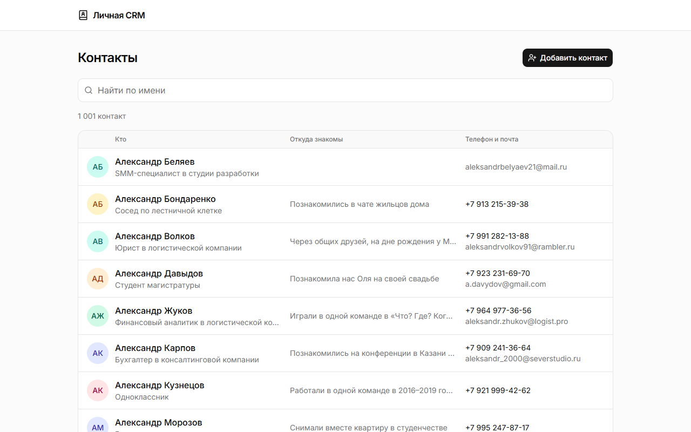
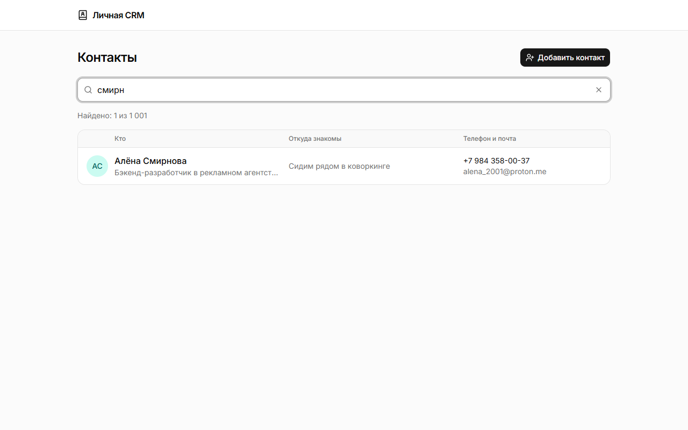
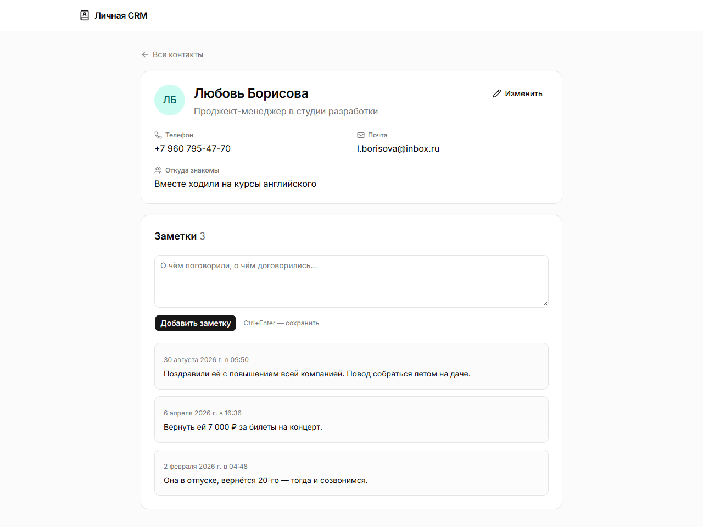
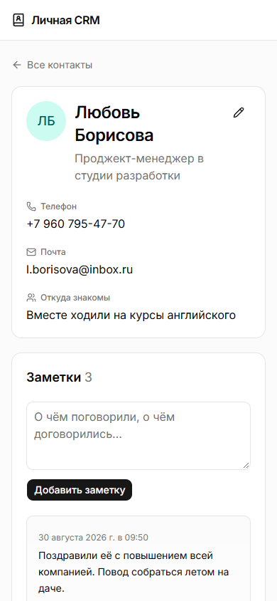

# Личная CRM

Контакты людей, которых я знаю лично: кто это, откуда знакомы, телефон и почта, заметки о разговорах.

## Что умеет

- Список всех контактов, отсортированный по имени
- Поиск по имени: можно вводить часть имени и слова в любом порядке, «е» и «ё» не различаются
- Добавление контакта и изменение его данных
- Карточка контакта с заметками: у каждой заметки есть дата, новые сверху. Сохранить заметку можно кнопкой или сочетанием Ctrl+Enter

Данные хранятся в базе PostgreSQL на этом компьютере, поэтому в любом браузере видны одни и те же контакты.

Продуктовая идея, главный сценарий и критерии успеха — в [specs/01-продуктовая-идея.md](specs/01-продуктовая-идея.md).

## Как выглядит

Список всех контактов (на скриншотах — тестовые данные):



Поиск по части имени:



Карточка контакта с заметками о разговорах:



На телефоне:



## Как запустить

Нужны Docker Desktop, Node.js 24 и pnpm.

Скачайте проект и перейдите в его папку:

```
git clone https://github.com/smithORsmithy/digital-granny.git
cd digital-granny
```

### База данных (PostgreSQL в Docker)

1. Если файла `.env` ещё нет — скопируйте `.env.example` в `.env` и заполните значения.
2. Запустите базу:

   ```
   docker compose up -d
   ```

3. Проверьте, что база работает: в колонке STATUS должно быть `healthy`.

   ```
   docker compose ps
   ```

Данные хранятся в Docker-томе `personal-crm_pgdata` и не пропадают при остановке или перезапуске.
Команда `docker compose down -v` **удаляет все данные** базы.

### Приложение: первый запуск

Все команды выполняются в папке проекта.

1. Установите зависимости:

   ```
   pnpm install
   ```

2. Создайте таблицы в базе:

   ```
   pnpm db:migrate
   ```

3. По желанию — заполните базу тестовыми данными (1000 контактов с заметками). Если в базе уже есть хотя бы один контакт, команда ничего не меняет:

   ```
   pnpm db:seed
   ```

4. Соберите и запустите приложение:

   ```
   pnpm build
   pnpm start
   ```

5. Откройте в браузере http://localhost:3000

Остановить приложение — нажать Ctrl+C в окне терминала, где оно запущено.

### Последующие запуски

Если база уже запущена (`docker compose ps` показывает `healthy`), достаточно `pnpm start`.
После изменений в коде сначала снова выполните `pnpm build`.

Для разработки удобнее `pnpm dev`: изменения в коде видны в браузере сразу, без пересборки.

## Полезные команды

- остановить базу: `docker compose stop`
- открыть консоль базы: `docker compose exec db psql -U crm -d personal_crm`
- проверить код: `pnpm lint` и `pnpm typecheck`
- после изменения схемы таблиц (`src/db/schema.ts`): `pnpm db:generate`, затем `pnpm db:migrate`

## Где что лежит

- `src/app` — страницы: список (`page.tsx`), новый контакт, карточка и редактирование (`contacts/`)
- `src/components` — части интерфейса: список с поиском, формы контакта и заметки
- `src/lib/contacts` — чтение из базы, проверка полей и сохранение (выполняется только на сервере)
- `src/db` — схема таблиц и подключение к базе
- `drizzle` — миграции базы
- `scripts/seed.ts` — заполнение базы тестовыми данными
